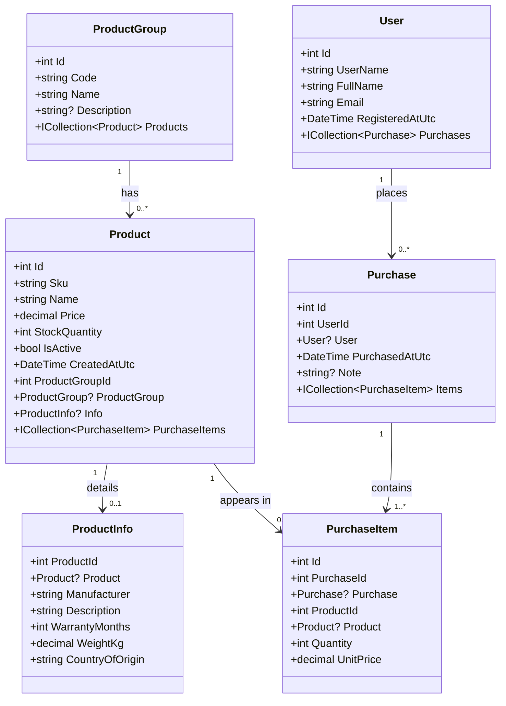

# Domain model

The demo domain is a car webshop: used cars, parts and accessories, plus who bought
what. The entities are deliberately generic - `Product`, `ProductGroup`, `ProductInfo`
rather than `Car`, `Engine`, `Tyre` - so the model stays readable and the same shape
fits any catalogue. Only the seed data is about cars.

## Class diagram



## The relationships, and why each one is there

| Relationship | Type | Why it is interesting |
|---|---|---|
| `ProductGroup` → `Product` | one-to-many | The classic parent-child case. The foreign key sits on the child (`Product.ProductGroupId`). |
| `Product` → `ProductInfo` | one-to-one | The descriptive fields live in a separate table. The primary key of `ProductInfo` **is** the foreign key, which is how EF Core models a one-to-one. |
| `User` → `Purchase` | one-to-many | A purchase makes no sense without a user, so deleting a user cascades. |
| `Purchase` → `PurchaseItem` | one-to-many | `Purchase` is the aggregate root: the lines only exist inside a purchase. |
| `Product` → `PurchaseItem` | one-to-many | The join entity between `Purchase` and `Product`. It is **not** a pure many-to-many, because the line carries data of its own (`Quantity`, `UnitPrice`). |

Two modelling decisions worth discussing with the group:

- **`PurchaseItem.UnitPrice` duplicates `Product.Price` on purpose.** The product price
  changes over time; what was paid must not. This is the difference between a
  *reference* and a *snapshot*, and getting it wrong is a classic reporting bug.
- **Delete behaviour differs per relationship.** `Purchase` → `PurchaseItem` cascades
  (the line belongs to the purchase), while `Product` → `PurchaseItem` is `Restrict`
  (a product that has been sold must not simply disappear).

## Seed data

All of it lives in one file, `Dal/Seed/SeedData.cs`, and is attached to the model with
EF Core `HasData`. The `IEntityTypeConfiguration` classes describe the *mapping*, the
seed file describes the *content* — the two change for different reasons, so they are
kept apart.

| Table | Rows |
|---|---|
| `ProductGroups` | 5 (Vehicles, Tyres and wheels, Engine and service, Brakes and suspension, Accessories) |
| `Products` | 12 — one with zero stock and one inactive, so the UI has something to show |
| `ProductInfos` | 12 (one per product) |
| `Users` | 3 customers |
| `Purchases` | 5 |
| `PurchaseItems` | 10 |

The provider is **EF Core InMemory**: the database is created and seeded on every
start (`InitializeDal()` in `Program.cs`) and disappears with the process.

> The in-memory provider is a test double, not a database. It has no SQL, no real
> transactions, and it does not enforce foreign keys or unique indexes. It is the
> right choice for a teaching skeleton; it is the wrong choice for verifying that a
> query works against a real database.

## Layer mapping

```
ProductManagement.Dal        Entities/, Configurations/, Seed/, ProductManagementDbContext
ProductManagement.Bll        Services/   (entities never leave this layer)
ProductManagement.Transfer   Dtos/       (the API contract, no dependencies)
ProductManagement.Web        Controllers/ (DTO in, DTO out)
ProductManagement.ClientApp  generated TypeScript client + pages
```

The entities stay inside Dal and Bll. What the controller returns is a **DTO** from
`ProductManagement.Transfer`, so the API contract does not change just because a
column was renamed — and the Angular
client is generated from that contract.
